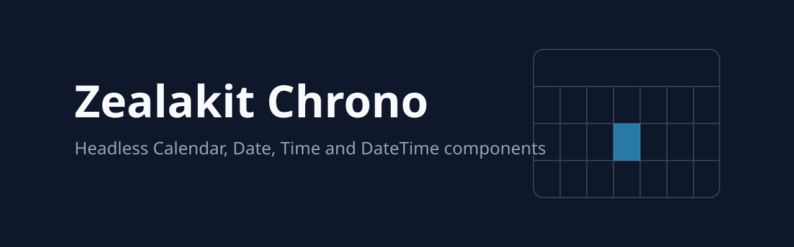

# @zealakit/chrono-core

[English](https://github.com/zealakit/chrono/blob/main/packages/core/README.md) | [Tiếng Việt](https://github.com/zealakit/chrono/blob/main/packages/core/README_VI.md) | [中文](https://github.com/zealakit/chrono/blob/main/packages/core/README_CN.md)



Zealakit Chrono 所有适配器共用的内部日历与日期/时间内核。Core 是私有包，从不发布到 npm：每个适配器都打包了自己的副本，因此应用代码使用对应框架的适配器。本文档面向在 monorepo 内工作的贡献者。

Core 不渲染任何内容，不附带 CSS，也没有运行时依赖。

> **Note**
> Chrono 正在开发中，尚无公开 API；目前没有任何包发布到 npm。它将提供相互独立、可组合的 Calendar、Date、Time 和 DateTime 能力，不附带任何 CSS，视觉完全由你掌控。
>
> Chrono 不是完整的 UI 库或设计系统，也不包含弹出层、overlay 或定位代码。需要弹出层时，请把 Chrono 的面板放进你自己的弹出层中。

## Install

```bash
pnpm --filter @zealakit/chrono-core run build
```

Core 不在 npm 上，因此无法安装。它在工作区内构建，并在发布时复制到每个适配器 tarball 的 `dist/vendor/core` 下。

## Public API

Core 提供 `.` 入口（`./foundation` 的再导出）和 `./foundation`。目前只有 foundation：还没有 Calendar、Date、Time 或 DateTime 目录，也没有任何组件。适配器尚未导入 core。

| Module | Folder | Contents |
| --- | --- | --- |
| `values` | `foundation/values/` | `PlainDate`、`PlainTime`、`PlainDateTime`、`ZonedDateTime`；epoch-day 运算、加减、边界、比较、ISO 8601、`Date` 转换、`today()` 与 `nowZoned()`。 |
| `locale` | `foundation/locale/` | `Intl` 封装：带 CLDR 回退表的周信息、月份与星期名称、小时制、文字方向、格式化、日期部分顺序。 |
| `constraints` | `foundation/constraints/` | `getDateStatus`、`getTimeStatus`、`snapTime`、`checkDateRange`、`checkTimeRange`、`createAvailability`。 |
| `ranges` | `foundation/ranges/` | 闭区间日期范围、半开区间、`splitIntervalByDay`。 |
| `grid` | `foundation/grid/` | `getMonthGrid`、`getMonths`、`getYearGrid`、`getDecadeGrid`、`getWeekdayHeaders`、`getTimeAxis`。 |
| `a11y` | `foundation/a11y/` | 纯函数 `nextFocusedDate`、日期与时间标签、默认英文文案。 |
| `store` | `foundation/store/` | `createStore`、`createControllable`、`getGlobalState`、`isBrowser`。 |

## Conventions

- 月份从 1 开始，星期一为 1。周规则来自 `Intl`，并内置回退表。
- 值是冻结的普通对象，由独立函数处理，没有类。
- 日期范围是闭区间，日期时间区间是半开区间。
- `values/` 中没有任何函数使用主机时区。请显式传入 `timeZone`、`now` 和 `locale`，SSR 尤其如此。
- 只提供英文状态词（`today`、`selected` 等）。应用通过传入 `messages` 自行翻译。
- `pnpm check:domains` 约束哪个目录可以导入哪个目录。core 测试套件按时区各运行一次，并且需要完整 ICU。

## License

MIT © Zealakit
