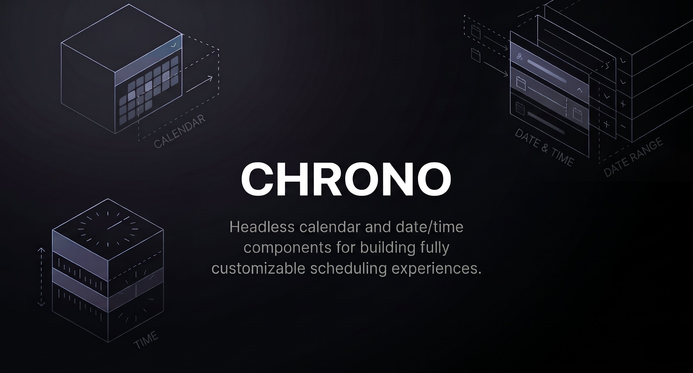

# @zealakit/chrono-react

[English](https://github.com/zealakit/chrono/blob/main/packages/react/README.md) | [Tiếng Việt](https://github.com/zealakit/chrono/blob/main/packages/react/README_VI.md) | [中文](https://github.com/zealakit/chrono/blob/main/packages/react/README_CN.md)



Các component Calendar headless cho React: view tháng, tuần, tuần làm việc, ngày, agenda, nhiều tháng và view tùy chỉnh, điều hướng và Mini Calendar. Bạn sở hữu toàn bộ styling.

Chrono không kèm CSS và không đặt style hiển thị. Các part render chính element và class của bạn; trạng thái được phơi bày qua thuộc tính `data-*` và ARIA, nên CSS của bạn quyết định mọi giao diện.

Trước 1.0: API có thể thay đổi giữa các bản minor.

> **Note**
> Chrono là bộ Calendar view headless tập trung và, ở các bản sau, các component Date, Time và DateTime. Nó không kèm CSS và không render markup có kiểu dáng, nên mọi quyết định visual đều thuộc về bạn. Bản 0.3.0 thêm event vào các Calendar view: bố cục, chọn, tràn "+N more" và vạch thời gian hiện tại. Entry `/date` mới thêm input và panel ngày; entry `/time` thêm input và panel giờ; component ngày-giờ chưa được triển khai.
>
> Chrono không phải là một UI library hay design system đầy đủ, và không kèm code popup, overlay hay định vị. Khi cần, hãy đặt panel của Chrono bên trong popup của riêng bạn.

## Install

```bash
npm install @zealakit/chrono-react
```

Peer dependency: `react` `^18.0.0 || ^19.0.0`, `react-dom` `^18.0.0 || ^19.0.0`.

## Calendar

### Quick start

Tạo một calendar rồi ghép các part của nó. Mọi part đều tùy chọn; chỉ render những gì bạn cần.

```tsx
import {
  Calendar,
  CalendarMonthGrid,
  CalendarNextButton,
  CalendarPrevButton,
  CalendarTitle,
} from "@zealakit/chrono-react";

export function Planner() {
  return (
    <Calendar locale="en-US" weekStartsOn={1}>
      <CalendarPrevButton>Prev</CalendarPrevButton>
      <CalendarTitle />
      <CalendarNextButton>Next</CalendarNextButton>
      <CalendarMonthGrid className="month" />
    </Calendar>
  );
}
```

### Import styles

Mỗi domain có thể import từ root entry và từ subpath riêng. Cả hai cho cùng một binding, nên bạn có thể dùng lẫn lộn.

```ts
// Domain subpath
import { Calendar, CalendarMonthGrid } from "@zealakit/chrono-react/calendar";

// Root entry: re-exports every domain, same bindings
import { Calendar, getCalendarTitle } from "@zealakit/chrono-react";
```

Root cũng re-export các utility này, nên Server Component hoặc server action có thể gọi chúng mà không tải code component.

### Parts

| Part | Renders | Purpose |
| --- | --- | --- |
| `Calendar` | `div` | Tạo calendar. Nhận các option bên dưới. |
| `CalendarTitle` | `h2` | Văn bản tiêu đề. Được thông báo nhẹ nhàng khi thay đổi. |
| `CalendarPrevButton`, `CalendarNextButton`, `CalendarTodayButton` | `button` | Điều hướng. Nút trước và sau có `aria-disabled` tại `min` và `max`. |
| `CalendarViewButton` | `button` | Chuyển sang `view` của nó. `aria-pressed` đánh dấu nút đang hoạt động. |
| `CalendarMonthGrid` | `table` | Tiêu đề thứ, số tuần tùy chọn và một ô cho mỗi ngày. `month` chọn lưới của view nhiều tháng. |
| `CalendarWeekdayHeader`, `CalendarWeekNumber`, `CalendarCell` | `th`, `th`, `td` | Các mảnh của lưới tháng. Dùng chúng để tự xây lưới. |
| `CalendarTimeGrid` | `div` | Cột ngày và khung giờ, chưa có event. |
| `CalendarTimeGridColumnHeader` | `div` | Tiêu đề ngày có thể focus của lưới thời gian. |
| `CalendarTimeGridSlot` | `div` | Một khung giờ của một ngày. Chưa thể focus. |
| `CalendarAgenda`, `CalendarAgendaDay` | `ul`, `li` | Danh sách agenda và các ngày của nó. |
| `MiniCalendar` | `div` | Một calendar tháng, có thể đồng bộ với calendar chính. |
| `MiniCalendarTitle`, `MiniCalendarPrevButton`, `MiniCalendarNextButton` | `h2`, `button`, `button` | Tiêu đề và lật trang của Mini Calendar. |
| `MiniCalendarGrid`, `MiniCalendarWeekdayHeader`, `MiniCalendarCell` | `table`, `th`, `td` | Lưới của Mini Calendar và các mảnh của nó. |

### Calendar options

| Option | Type | Default | Description |
| --- | --- | --- | --- |
| `view` | `string` | — | Id view được điều khiển: `month`, `week`, `workWeek`, `day`, `agenda`, `multiMonth` hoặc view tùy chỉnh. |
| `defaultView` | `string` | `"month"` | View ban đầu khi uncontrolled. |
| `date` | `DateInput` | — | Ngày được điều khiển mà range được xây quanh. |
| `defaultDate` | `DateInput` | today | Ngày ban đầu khi uncontrolled. |
| `onViewChange` | `(view) => void` | — | View đã thay đổi. |
| `onDateChange` | `(date) => void` | — | Ngày mà range được xây quanh đã thay đổi. |
| `onVisibleRangeChange` | `(range, { view }) => void` | — | Chạy một lần sau khi mount và mỗi khi visible range thay đổi. Hãy tải event cho range này. |
| `onDateActivate` | `(date, { view, source }) => void` | — | Một ngày được click hoặc nhấn Enter. Calendar không làm gì thêm; bạn quyết định ý nghĩa. |
| `views` | `Record<string, ViewDefinition>` | — | View tùy chỉnh, gộp lên các view có sẵn. |
| `locale` | `string` | runtime locale | Thẻ BCP 47. Hãy truyền khi render phía server. |
| `weekStartsOn` | `1`–`7` | locale | Ngày đầu tuần, 1 = Thứ Hai. |
| `hiddenDays` | `DayOfWeek[]` | `[]` | Ẩn các thứ trong mọi layout. |
| `timeZone` | `string` | runtime zone | Múi giờ IANA dùng để xác định hôm nay là ngày nào. |
| `now` | `number` | `Date.now()` | Epoch millisecond dùng làm hiện tại. Hãy truyền khi render phía server. |
| `min`, `max` | `DateInput` | — | Giới hạn điều hướng. Các ngày ngoài khoảng được đánh dấu `data-disabled`. |
| `timeGrid` | `{ start, end, step, workingHours }` | 30-minute slots | Trục thời gian của lưới thời gian. `step` tính bằng phút; `workingHours` là `{ start, end, days }`. |
| `weekNumbers` | `"iso" \| "locale" \| false` | `false` | Hiện số tuần trong lưới tháng. |
| `messages` | `Partial<Messages>` | English | Tên truy cập và từ trạng thái. Chỉ có tiếng Anh; hãy truyền bản của bạn để dịch. |
| `selectedDate` | `DateInput` | — | Đánh dấu một ngày `data-selected`. Calendar không bao giờ đổi nó; bạn đặt nó, ví dụ từ `onDateActivate`. |
| `highlightedDates` | `DateInput[] \| (date) => boolean` | — | Đánh dấu các ngày `data-highlighted`. |

### Views

View là dữ liệu: một layout, một độ dài và một cách căn. Thêm view của bạn qua `views`.

| View | Layout | Range |
| --- | --- | --- |
| `month` | month | Một tháng kèm các ngày kề, 6 hàng. |
| `week` | time grid | Một tuần. |
| `workWeek` | time grid | Một tuần không có cuối tuần của locale. |
| `day` | time grid | Một ngày. |
| `agenda` | list | Bảy ngày kể từ ngày đó. |
| `multiMonth` | month | Ba tháng. |

```tsx
<Calendar
  views={{ threeDay: { layout: "time-grid", length: { days: 3 }, align: "day" } }}
  defaultView="threeDay"
/>
```

### Controlled usage

Để trống `view` và `date` để dùng uncontrolled, hoặc tự điều khiển chúng. Calendar chỉ báo thay đổi và không bao giờ lưu trữ gì.

```tsx
const [view, setView] = useState("month");
const [date, setDate] = useState(toPlainDate("2026-11-17"));

<Calendar view={view} onViewChange={setView} date={date} onDateChange={setDate} />
```

### Mini Calendar

Mini Calendar có tháng riêng. Truyền `syncWith` và nó sẽ theo calendar chính khi ngày chính rời khỏi tháng của nó; người dùng vẫn có thể lật trang độc lập.

```tsx
<MiniCalendar
  syncWith={range ? { date, visibleRange: range } : undefined}
  isMarked={(day) => hasEvents(day)}
  onNavigate={setDate}
>
  <MiniCalendarPrevButton />
  <MiniCalendarTitle />
  <MiniCalendarNextButton />
  <MiniCalendarGrid />
</MiniCalendar>
```

`MiniCalendar` nhận `month` / `defaultMonth` / `onMonthChange`, `syncWith` (`{ date, visibleRange }` của calendar chính), `isMarked` (`(date) => boolean`, ví dụ các ngày có event), `onNavigate` (`(date) => void`) và các option dùng chung `locale`, `weekStartsOn`, `timeZone`, `now`, `min`, `max`, `weekNumbers`, `messages`, `selectedDate` và `highlightedDates`.

### Keyboard

| Key | Action |
| --- | --- |
| `←` `→` | Ngày trước hoặc sau. Đảo chiều trong locale phải sang trái. |
| `↑` `↓` | Tuần trước hoặc sau trong lưới tháng; ngày trước hoặc sau trong agenda. |
| `Home` `End` | Đầu hoặc cuối tuần, hoặc ngày đầu hoặc cuối của lưới thời gian hay agenda. |
| `PageUp` `PageDown` | Range trước hoặc sau (tháng, tuần, ...). Trong lưới tháng, `Shift` chuyển một năm. |
| `Enter` | Kích hoạt ngày đang focus (`onDateActivate`). |

### Server rendering

Truyền `now` và `locale` (và `timeZone`) để server và client render cùng một markup. Nếu không, Chrono đọc đồng hồ và locale của runtime, vốn khác nhau giữa server và trình duyệt.

```tsx
<Calendar now={now} locale="en-US" timeZone="UTC" />
```

## React Server Components

Component và hook là client component. Các utility (`getCalendarTitle`, `getRange`, `getVisibleRange`, `toPlainDate`, `toIsoString`, `isSameDay`) không có directive, nên Server Component và server action gọi được chúng từ cả hai entry.

```ts
// A Server Component: no "use client" needed for utilities.
import { getCalendarTitle, getRange } from "@zealakit/chrono-react/calendar";
```

## Events

Truyền `events` và render segment của từng ô bằng `CalendarEvents` và `CalendarEvent`; Chrono tính lane, cột, tràn và cờ tiếp nối, bạn render nội dung. Dùng `eventLimit="auto"` để đo ô hiển thị và lắng nghe `onSelectRange` cho kéo-tạo.

```tsx
<Calendar events={events} eventLimit="auto" onSelectRange={create}>
  <CalendarMonthGrid>
    {(day) => (
      <CalendarEvents day={day}>
        {(segments) =>
          segments.map((segment) => (
            <CalendarEvent key={segment.key} segment={segment} />
          ))
        }
      </CalendarEvents>
    )}
  </CalendarMonthGrid>
</Calendar>
```

| Part | Renders | Purpose |
| --- | --- | --- |
| `CalendarEvents` | `div` | Danh sách event của một ô; render prop nhận segment của ô đó. |
| `CalendarEvent` | `div` | Một segment, với `segment.event` là object gốc của bạn. |
| `CalendarMoreButton` | `button` | Nút "+N more"; phát `onMoreActivate`. |
| `CalendarAllDayRow` | `div` | Hàng all-day của time grid; render prop nhận `{ days, segments }`. |
| `CalendarNowIndicator` | `div` | Vạch thời gian hiện tại, chỉ render khi nằm trong trục. |
| `CalendarSelectionPreview` | `div` | Một mảnh preview chọn cho mỗi ngày bị phủ. |

Vị trí event là số không đơn vị trong các custom property `--chrono-event-*`, nên CSS của bạn quyết định đơn vị và cách bố trí. `Enter` hoặc `F2` vào event của một ô, `Space` chọn, `Enter` kích hoạt và `Escape` quay về ngày.

## Date

Năm component độc lập, không style: `DateInput`, `DatePanel`, `DateRangeInput`, `DateRangePanel` và `MultiDatePanel`. Chúng chạy riêng lẻ, cùng nhau qua một giá trị chung và bên trong bất kỳ popup nào bạn chọn. Chrono không có popup: mở, định vị và đóng đều thuộc về app của bạn.

### Date quick start

Dùng chung một giá trị giữa ô nhập và panel. Gõ sẽ đưa panel tới tháng đó; chọn một ngày sẽ điền vào ô nhập.

```tsx
import { useState } from "react";
import { DateInput, DatePanel } from "@zealakit/chrono-react/date";
import type { DateValue } from "@zealakit/chrono-react/date";

export function Booking() {
  const [value, setValue] = useState<DateValue>(null);
  return (
    <>
      <DateInput value={value} onValueChange={setValue} name="check-in" />
      <DatePanel value={value} onValueChange={setValue} />
    </>
  );
}
```

### Date parts

Mọi part đều tùy chọn. Panel hoặc input không có children sẽ vẽ bố cục mặc định; hãy ghép các part theo ý bạn.

| Part | Default element | Notes |
| --- | --- | --- |
| `DateInput` | `div` | Group of segments, or a text field with `mode="text"` |
| `DateInputSegment, DateInputLiteral` | `span` | One part (spinbutton) and a separator |
| `DateInputTextField, DateInputClearButton` | `input, button` | Text mode field and clear |
| `DateRangeInput, DateRangeInputStart, DateRangeInputEnd` | `div` | Two fields in one group |
| `DatePanel, DateRangePanel, MultiDatePanel` | `div` | The three panel roots; range shows two months |
| `DatePanelTitle, DatePanelLevelButton` | `h2, button` | Title, and the title as a level switch |
| `DatePanelPrevButton, DatePanelNextButton, DatePanelTodayButton` | `button` | Paging and today |
| `DatePanelGrid, DatePanelWeekdayHeader, DatePanelWeekNumber, DatePanelCell` | `table, th, td` | The grid of the current level |

### Change and commit

`onValueChange` chạy ở mọi thay đổi, kể cả khoảng chọn dở dang. `onValueCommit` chạy khi lựa chọn hoàn tất: đã chọn một ngày, khoảng có đủ hai đầu, hoặc giá trị gõ hợp lệ khi blur hay Enter. Hãy đóng popup khi commit. Chọn nhiều ngày không tự commit; hãy gọi `commit()`.

### Date keyboard

Phím mũi tên, Home/End và PageUp/PageDown di chuyển focus. Enter hoặc Space để chọn (đảo chọn trong panel nhiều ngày; Shift+Enter thêm cả đoạn từ ngày trước). Ctrl hoặc Cmd cùng ArrowUp lên một cấp (ngày, tháng, năm). Escape hủy khoảng chọn dở dang, còn lại không xử lý để popup của bạn đóng được. Trong input, gõ số sẽ tự chuyển ô, ArrowUp và ArrowDown tăng giảm có vòng lặp, Backspace xóa một phần và ArrowLeft, ArrowRight chuyển giữa các phần (đảo chiều với ngôn ngữ phải sang trái).

### Forms and validity

Đặt `name` và root sẽ render một input ẩn mang giá trị ISO (`2026-11-17`). Khoảng ngày dùng `name-start` và `name-end` (hoặc `startName` và `endName`); panel nhiều ngày không phải là field. Reset form khôi phục `defaultValue`. Input không hợp lệ giữ nguyên nội dung đã gõ và báo `validity` (`empty`, `incomplete`, `invalid-date`, `before-min`, `after-max`, `disabled`, `unavailable`, `valid`) qua `aria-invalid` và `data-invalid`; nội dung lỗi do bạn viết.

### Range presets

`getPresetRange(preset, { today, weekStartsOn, fiscalYearStartMonth })` trả về khoảng ngày (gồm cả hai đầu) của `today`, `yesterday`, `last7Days`, `last30Days`, `thisWeek`, `lastWeek`, `thisMonth`, `lastMonth`, `thisQuarter`, `lastQuarter`, `yearToDate`, `thisYear`, `lastYear` hoặc preset tùy chỉnh `{ unit, amount, align }`. `matchPreset` cho biết preset nào khớp giá trị hiện tại, dùng cho `aria-pressed` trên nút của bạn. Preset chỉ là hàm thuần: nút do bạn tự làm.

### Popup recipes

Đặt panel vào bất kỳ thư viện popup nào: bật `autoFocus` để focus chuyển vào panel (mặc định tắt để panel inline không giành focus), đóng khi `onValueCommit` và để popup trả focus. Panel không chặn Escape trừ khi vừa hủy một khoảng chọn dở dang. Kiểu foundation `DateInput` được adapter xuất ra với tên `DateInputValue`, vì `DateInput` giờ là một component.

## Time

Bốn component độc lập, không style, không có ngày và không có múi giờ: `TimeInput`, `TimePanel`, `TimeRangeInput` và `TimeRangePanel`. Phù hợp với giờ mở cửa, giờ làm việc, lịch hằng ngày và khung giờ hẹn. Giống các component Date, chúng không có popup riêng.

### Time quick start

Dùng chung một giá trị giữa ô nhập dạng phân đoạn và panel. Gõ sẽ cập nhật panel; chọn một mục sẽ điền vào ô nhập.

```tsx
import { useState } from "react";
import { TimeInput, TimePanel } from "@zealakit/chrono-react/time";
import type { TimeValue } from "@zealakit/chrono-react/time";

export function Opening() {
  const [value, setValue] = useState<TimeValue>(null);
  return (
    <>
      <TimeInput value={value} onValueChange={setValue} name="opens" />
      <TimePanel value={value} onValueChange={setValue} step={{ minutes: 15 }} />
    </>
  );
}
```

### Time parts

Mọi part đều tùy chọn. Panel không có children sẽ vẽ bố cục mặc định.

| Part | Default element | Notes |
| --- | --- | --- |
| `TimeInput` | `div` | Group of segments, or a text field with `mode="text"` |
| `TimeInputSegment, TimeInputLiteral` | `span` | One part (spinbutton) and a separator |
| `TimeInputTextField, TimeInputClearButton` | `input, button` | Text mode field and clear |
| `TimeRangeInput, TimeRangeInputStart, TimeRangeInputEnd` | `div` | Two fields in one group |
| `TimePanel, TimeRangePanel` | `div` | Both layouts; a range list is the default |
| `TimePanelColumn` | `div` | Columns layout: one listbox per part |
| `TimePanelList, TimePanelGroup, TimePanelGroupLabel` | `div` | List layout and its groups |
| `TimePanelOption` | `div` | One time or slot; custom content can read `slot.data` |
| `TimeRangePanelStart, TimeRangePanelEnd` | `div` | Columns layout of a range: one column set each |

### Layouts and slots

`layout="columns"` hiện một listbox cho mỗi phần (giờ, phút, giây, buổi). `layout="list"` hiện một listbox các mốc giờ cách nhau `step`, hoặc các slot với `slotDuration` hay mảng `slots` tường minh (`{ start, end?, available?, data? }`). `data` của slot do bạn quyết định: đọc nó trong nội dung option. `groupBy` nhận `"hour"`, `"dayPeriod"` (nhãn lấy từ `Intl`) hoặc hàm của bạn. `granularity` là `hour`, `minute` hoặc `second`, `hourCycle` là `h12` hoặc `h23` (mặc định theo locale) và `step` đặt khoảng phút hoặc giây. Giờ hoặc mục không được phép vẫn focus được nhưng không chọn được.

### Overnight ranges

Khoảng giờ là nửa mở `[start, end)`. Với `allowOvernight`, `end` trước `start` nghĩa là ngày hôm sau (`23:00` đến `02:00`, `duration` 180 phút, `crossesMidnight` là true). `09:00` đến `09:00` luôn là `end-before-start`. `minDuration` và `maxDuration` (phút) đánh dấu các mục vi phạm bằng `data-range-blocked`. Trong danh sách, hai lần chọn tạo thành một khoảng: với `slotDuration`, điểm cuối là cuối của slot được chọn.

### Time keyboard

Một panel là một điểm dừng Tab. Với cột, mũi tên trái phải đổi cột, mũi tên lên xuống di chuyển trong cột, Home và End nhảy tới hai đầu, PageUp và PageDown di chuyển 3 giờ hoặc 15 phút, gõ số để nhảy nhanh (`1` rồi `5` focus vào 15) và Enter hoặc Space để chọn. Với danh sách, mũi tên lên xuống, Home, End, PageUp và PageDown di chuyển và gõ số để nhảy nhanh. Escape chỉ hủy khoảng chọn dở dang. Trong input, gõ số sẽ tự chuyển ô, ArrowUp và ArrowDown tăng giảm theo `step` có vòng lặp, và gõ `a` hoặc `p` (chữ cái đầu của nhãn địa phương hóa) để đặt buổi.

### Time forms and validity

Đặt `name` và root sẽ render một input ẩn với `09:30` (`09:30:15` khi `granularity="second"`); khoảng giờ dùng `name-start` và `name-end`. Giá trị đã gõ không bao giờ bị sửa: giá trị lệch `step` được giữ nguyên và báo `validity: "off-step"` (có `snapTime` nếu bạn muốn làm tròn khi blur). Các trạng thái khác là `empty`, `incomplete`, `before-min`, `after-max`, `disabled`, `unavailable`, `valid`, cùng `end-before-start`, `too-short` và `too-long` cho khoảng giờ. Ở chế độ text, `9`, `930`, `9:30`, `9.30`, `9h30`, `21:30`, `9:30 pm` và `9 PM` đều được hiểu.

### Time popup recipes

Đặt panel vào bất kỳ thư viện popup nào như panel Date: bật `autoFocus` trong popup, đóng khi `onValueCommit` (cột cuối của bộ cột kết thúc với khoảng giờ dạng cột) và để popup trả focus. Kiểu foundation `TimeInput` được adapter xuất ra với tên `TimeInputValue`, vì `TimeInput` giờ là một component. `BookingSlot` là kiểu slot (`TimeSlot` của foundation là slot trục thời gian của Calendar).

## Styling hooks

| Attribute | Where | Purpose |
| --- | --- | --- |
| `data-chrono-calendar` | root | Đánh dấu root của calendar. `data-view` và `data-layout` cho biết view và layout đang dùng. |
| `data-today` | cells, headers | Ngày là hôm nay. `aria-current="date"` cũng được đặt. |
| `data-selected`, `data-highlighted` | cells, headers | Được đặt từ `selectedDate` và `highlightedDates`. |
| `data-outside-month`, `data-weekend`, `data-hidden` | cells | Ngày nằm ngoài tháng đang hiển thị, vào cuối tuần, hoặc bị ẩn qua `hiddenDays`. |
| `data-focused` | cells, headers | Ngày giữ roving tabindex. Hãy style `:focus-visible` cho vòng focus bàn phím. |
| `data-disabled` | cells, nav buttons | Nằm ngoài `min` và `max`, hoặc không thể điều hướng thêm. `aria-disabled` cũng được đặt. |
| `data-marked`, `data-in-range` | Mini Calendar cells | Từ `isMarked`, và nằm trong visible range đã đồng bộ. |
| `data-slot-start`, `data-working-hours` | time grid slots | Giờ bắt đầu của khung giờ, và nó có nằm trong giờ làm việc không. |
| `data-chrono-key` | cells, headers | Ngày ISO của ô. Hữu ích cho test và listener ủy quyền. |

## Agent Skill

[Skill Chrono React](https://github.com/zealakit/chrono/blob/main/skills/chrono-react.md) mô tả các bước tích hợp cho agent.

## License

MIT © Zealakit
